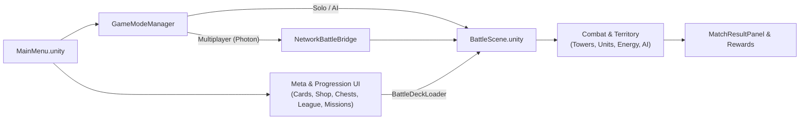

<div align="center">

# ⚔️ Kings of Siege

**A stylized 3D medieval real-time strategy & card-based tower siege game built with Unity 6 (URP).**

[](https://unity.com/)
[](https://docs.unity3d.com/Packages/com.unity.render-pipelines.universal@latest)
[](https://git-lfs.com/)
[](https://learn.microsoft.com/en-us/dotnet/csharp/)

</div>

---

## 🎮 Overview

**Kings of Siege** combines real-time lane/territory siege combat with collectible card deck-building and kingdom progression. Players build and upgrade a deck of medieval units (archers, cavalry, spearmen, catapults, ballistas, rams, casters, and peasants), deploy them using a segmented energy system, capture and defend towers, and compete across single-player AI and networked multiplayer battles.

---

## 📸 Visual Showcase

<table>
  <tr>
    <td align="center" width="50%">
      
      <br/><sub><b>Cards & Deck Builder</b> — Collect, upgrade, and equip battle decks</sub>
    </td>
    <td align="center" width="50%">
      
      <br/><sub><b>Kingdom Road</b> — Milestone progression and reward track</sub>
    </td>
  </tr>
  <tr>
    <td align="center" width="50%">
      
      <br/><sub><b>Daily Rewards</b> — Streak rewards and animated claim popups</sub>
    </td>
    <td align="center" width="50%">
      
      <br/><sub><b>Leaderboards</b> — Global, local, and clan rankings</sub>
    </td>
  </tr>
  <tr>
    <td align="center" width="50%">
      
      <br/><sub><b>Territory & Tower Control</b> — Dynamic frontline shift indicators</sub>
    </td>
    <td align="center" width="50%">
      
      <br/><sub><b>Match Results</b> — Post-battle breakdown and victory rewards</sub>
    </td>
  </tr>
</table>

---

## ✨ Key Features

- **Real-Time Siege Combat:** Deploy troops with a segmented energy bar (`SegmentedEnergySliderController`), push territory borders (`TerritoryShiftIndicator`), garrison and capture towers (`TowerCombatController`, `TowerGarrisonZone`), and track dominance (`BattleDominanceHealthBar`).
- **Card Collection & Deck System:** Full card inventory, upgrades with celebration overlays, and persistent battle deck loading (`Assets/scripts/Cards/` & `Assets/scripts/CardsScreen/`).
- **Smart AI & Multiplayer:** Local AI opponent (`SmartAIPlayer`, `BattleAIManager`, `EnemyAISpawner`) alongside Photon-powered networked battle synchronization (`NetworkBattleBridge`, `NetworkUnitSync`).
- **Meta Progression & Live-Ops UI:**
  - **Kingdom Road** (`Assets/scripts/KingdomRoad/`) & **Leagues** (`Assets/scripts/League/`)
  - **Chests, Daily Rewards & Shop** (`Assets/scripts/Chests/`, `Assets/scripts/DailyRewards/`, `Assets/scripts/Shop/`)
  - **Missions, Profile & Rankings** (`Assets/scripts/Missions/`, `Assets/scripts/Profile/`, `Assets/scripts/Rankings/`)
  - **Interactive Tutorial** (`Assets/scripts/Tutorial/`)
- **Juicy Feedback & Audio:** Hit feedback, cinematic camera & swipe controls, object pooling (`SimpleGameObjectPool`), and centralized audio (`KoSAudio`).

---

## 🧭 Architecture



---

## 🛠️ Tech Stack & Packages

| Component | Version / Details |
| :--- | :--- |
| **Unity Editor** | `6000.0.43f1` |
| **Render Pipeline** | Universal Render Pipeline (`com.unity.render-pipelines.universal` `17.3.0`) |
| **VFX & UI** | Visual Effect Graph (`17.0.4`), UGUI (`2.0.0`), UI Toolkit, TextMesh Pro |
| **Navigation & Input** | AI Navigation (`2.0.16`), Input System (`1.16.0`), Timeline (`1.8.9`) |
| **Networking** | Photon (`Assets/Photon/`) |
| **Tooling** | Unity MCP (`com.coplaydev.unity-mcp`) |

---

## 📁 Project Structure

```text
Kings-of-Siege/
├── Assets/
│   ├── AnimationController/   # Unit & siege weapon animator controllers
│   ├── Scenes/
│   │   ├── MainMenu.unity
│   │   └── SampleScene 1/BattleScene.unity
│   ├── scripts/               # Core gameplay & modular UI/meta systems
│   │   ├── Audio/             ├── Cards/             ├── CardsScreen/
│   │   ├── Chests/            ├── DailyRewards/      ├── Editor/
│   │   ├── KingdomRoad/       ├── League/            ├── Missions/
│   │   ├── Powerups/          ├── Profile/           ├── Rankings/
│   │   ├── Settings/          ├── Shop/              ├── Tutorial/
│   │   └── UI/
│   ├── prefabs/               # Units, towers, VFX, UI prefabs
│   ├── Screenshots/           # Development & UI showcase captures
│   └── ...                    # Art, terrain, shaders, and third-party packs
├── Captures/                  # UI & reward flow captures
├── Packages/                  # Unity Package Manager manifest & lockfile
├── ProjectSettings/           # Unity project, build, input, and URP settings
├── .gitattributes             # Git LFS tracking rules for binary assets
└── .gitignore                 # Unity-specific ignore rules
```

---

## 🚀 Getting Started

This repository uses **Git LFS** for textures, 3D models, audio, fonts, and large terrain assets. Make sure Git LFS is installed before cloning.

```bash
# 1. Install Git LFS (one-time setup)
git lfs install

# 2. Clone the repository
git clone https://github.com/sahilchy1234/Kings-of-Siege.git
cd Kings-of-Siege

# 3. Ensure all LFS assets are downloaded
git lfs pull
```

### Opening in Unity
1. Open **Unity Hub** and click **Add project from disk**.
2. Select the cloned `Kings-of-Siege` folder.
3. Open with **Unity `6000.0.43f1`** (allow Unity to rebuild `Library/` on first launch).
4. Load `Assets/Scenes/MainMenu.unity` and press **Play**.
